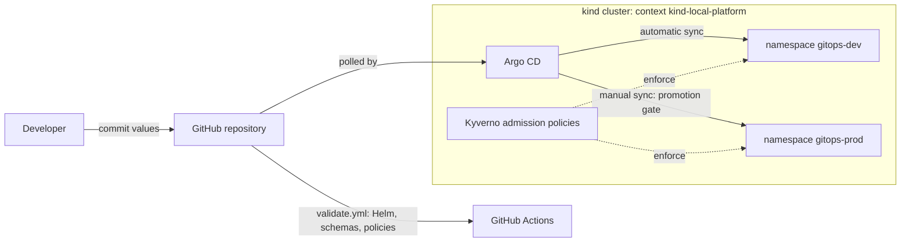

# GitOps Deployment Platform (P02)

Git-driven deployment of the P01 application to dev and prod namespaces on the local kind cluster, using Argo CD, Helm and Kyverno. It is local-only and creates no cloud resources.

**Verification:** dev auto-sync, the prod manual gate, promotion, rollback, self-heal and Kyverno admission pass `tests/verify-gitops.sh` against the disposable local Git server.

## Architecture



## Layout

| Path | Purpose |
|---|---|
| `charts/local-platform-app/` | Helm chart copied from P01 |
| `environments/{dev,prod}/values.yaml` | Image tag for each environment |
| `argocd/` | AppProject and one Application per environment |
| `policies/` | Kyverno rules: non-root, resources, versioned image tags |
| `bootstrap/` | Minimal Argo CD and Kyverno Helm values |
| `scripts/` | Bootstrap, image loading and promotion |
| `tests/` | Promotion test and offline chart and policy validation |

## Prerequisites

P01 kind cluster running, image `local-platform-app:dev` built, and this repository pushed to `https://github.com/satyum/gitops-deployment-platform.git` on branch `main`. A private repository also needs an Argo CD repository credential: store it in a Kubernetes Secret and never commit it.

## Deploy

```bash
./scripts/load-image.sh 0.1.0
./scripts/load-image.sh 0.1.1
./scripts/bootstrap.sh
```

Access Argo CD on loopback only:

```bash
kubectl --context kind-local-platform -n argocd port-forward svc/argocd-server 8443:443
```

## Demo flow

1. Commit a new tag to `environments/dev/values.yaml`. Argo CD syncs `local-platform-dev` automatically.
2. Run `./scripts/promote.sh`, review the diff, then commit and push it.
3. Sync `local-platform-prod` manually in Argo CD, or run `./scripts/sync-prod.sh`.
4. Roll back with `git revert` on the promotion commit, push, and sync prod again.

## Local demo without a hosted repository

`demo/local-git-server.yaml` runs a disposable, read-only Git server in namespace `gitops-git`. Its history lives in an `emptyDir` and is lost when the Pod is deleted or replaced. Commits are made inside the Pod, so this directory's Git state is never touched.

```bash
./scripts/local-git.sh up
./scripts/local-git.sh seed
GITOPS_REPO_URL=git://local-git.gitops-git.svc.cluster.local/platform.git ./scripts/bootstrap.sh
tests/verify-gitops.sh
```

`verify-gitops.sh` drives the whole flow and restores dev to `0.1.1` and prod to `0.1.0`. It expects those starting tags. To drive steps by hand, use `scripts/local-git.sh set-dev-tag <x.y.z>`, `promote` and `revert-last`, and `scripts/sync-prod.sh` for the prod gate.

The server has no authentication, so use it only for this local demo.

## Tests

```bash
tests/test_promote.sh
tests/validate.sh
```

`validate.sh` needs Helm and Docker. It renders both environments, checks schemas with Kubeconform, runs the Kyverno CLI, and requires `tests/fixtures/bad-deployment.yaml` to be rejected.

## Security

Policies apply only to `gitops-dev` and `gitops-prod`. Both namespaces carry the Pod Security `restricted` label. The AppProject limits this repository to those namespaces and to Deployment, Service and Namespace resources. Repository credentials never belong in Git.

## Troubleshooting

| Symptom | Cause | Fix |
|---|---|---|
| `argocd-repo-server` in `CrashLoopBackOff` with `failed to create fsnotify Watcher: couldn't initialize inotify: too many open files` | Host `fs.inotify.max_user_instances` is too low for the cluster | `sudo sysctl fs.inotify.max_user_instances=512`, which lasts until reboot; then rerun `scripts/bootstrap.sh` |

## Phase 2 improvements

- Migrate from `ClusterPolicy`, which Kyverno v1.19 reports as deprecated, to `ValidatingPolicy`.
- Build real image versions. Tags `0.1.0` and `0.1.1` currently point to the same image.
- Add AI-assisted deployment review and Argo CD monitoring.
